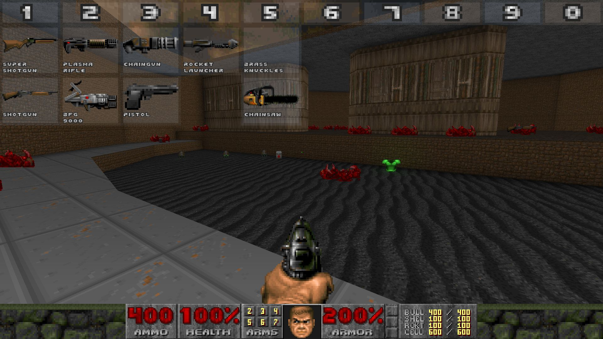
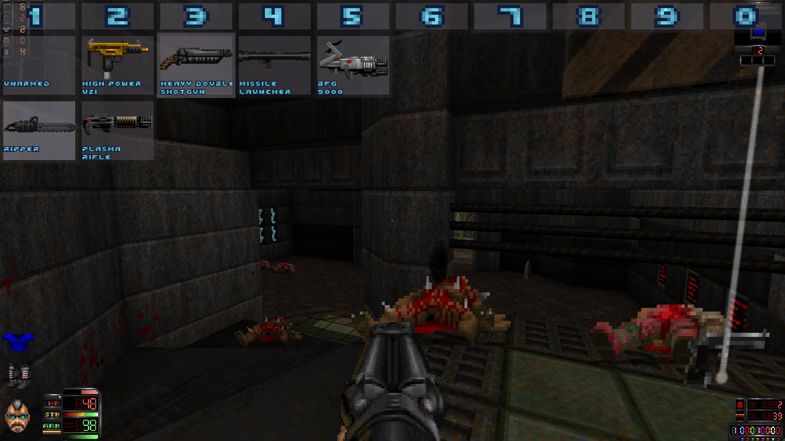
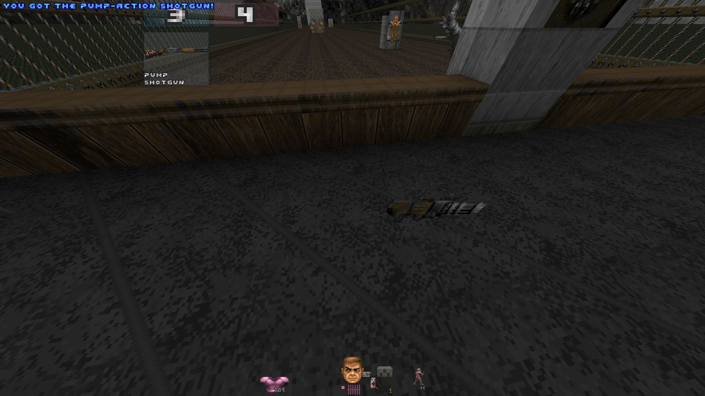

# Lemon's Smart Slots For UZDoom
My implementation for customizable slots for weapons in UZDoom.
It is designed for singleplayer and multiplayer, and should work with any mods that add/replace weapons.

To use, press the "Edit Slots" key (default ') to open the user interface.
You can then click each weapon to insert into a different slot.
You can also click and drag weapons to swap the two!

There are also keys for next and previous weapons (usually bound to the scroll wheel) and a key to switch to your last held weapon!

Many of the settings like the colors, alpha/transparency, and previews are customizable and/or toggleable!

Installing mid-map requires a level change!

## Addons
[Icon Addon for Hideous Destructor](https://github.com/Lemonadedrinker/Lemons-Smart-Slots-Icon-Addon-For-HDest), which shows every HDest weapon frame and variant.

## Previews
### Doom 2

### Hideous Destructor [(Link to the Mod)](https://codeberg.org/mc776/HideousDestructor)

This screenshot has the [Icon Addon for Hideous Destructor](https://github.com/Lemonadedrinker/Lemons-Smart-Slots-Icon-Addon-For-HDest) to display every HDest weapon frame and variant.
### Doom Roguelike Arsenal [(Link to the Mod)](https://forum.zdoom.org/viewtopic.php?t=37044)

### Pickup and Drop Preview
Playing through a mod with a lot of picking up and dropping weapons?
LSS shows pickup and drop previews! (Both toggleable!)

The shotgun (slot 3) was picked up, and the vulcanette (slot 4) was dropped.

## Credits:
Thank you to [mickromash](https://github.com/mickromash) for [their original mod](https://github.com/mickromash/CustomSlots) this was inspired by.
